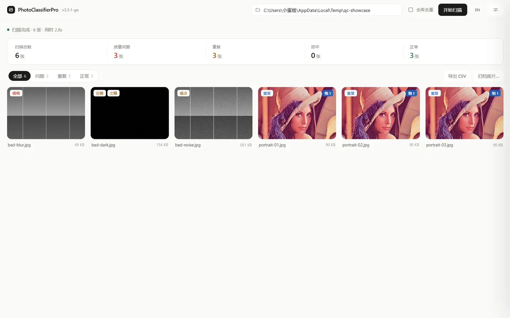
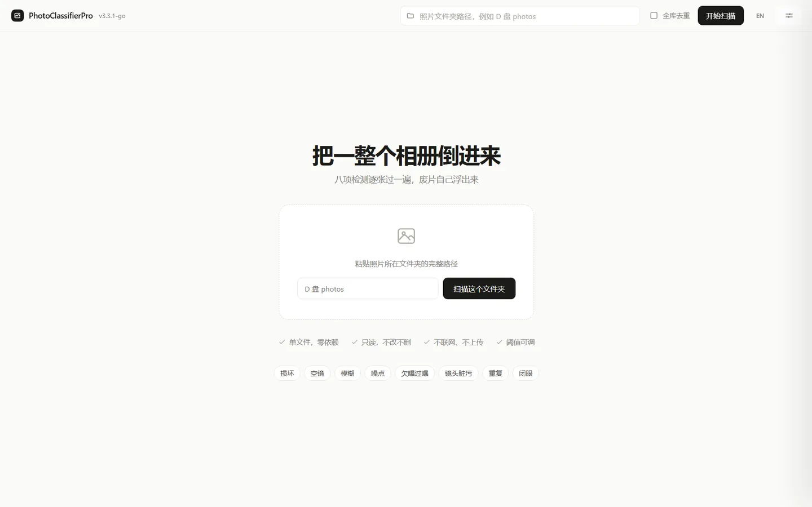
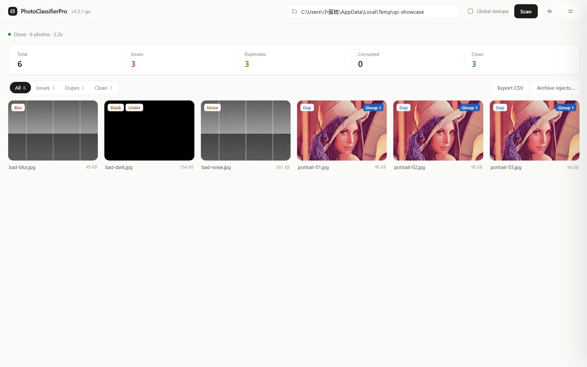
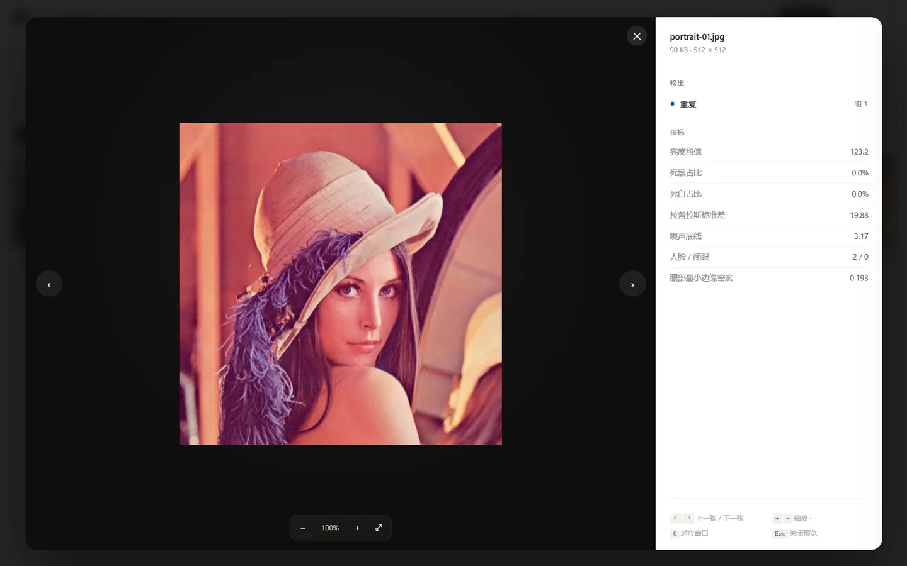
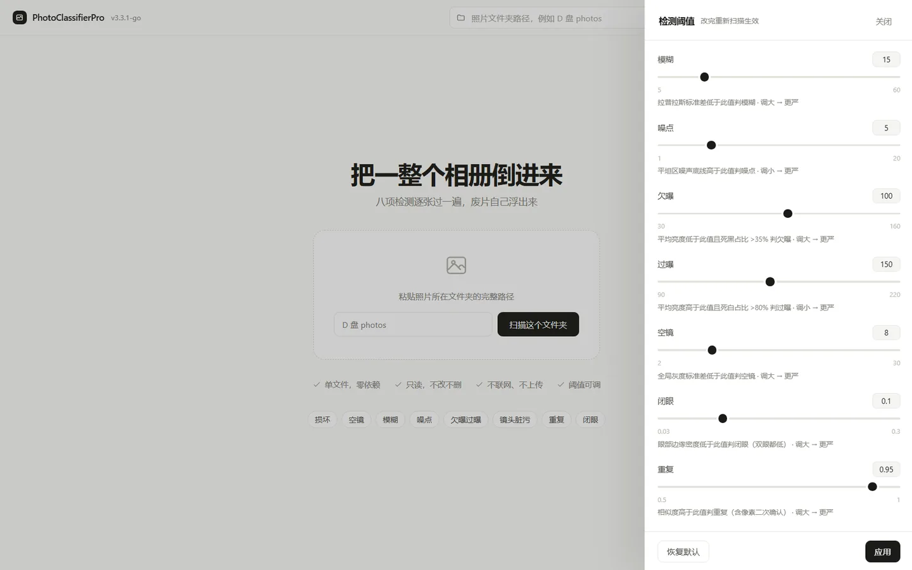

# PhotoClassifierPro

> **定位：预览版（Preview）。**
> 新功能先在这里落地，可能不稳定 —— 这是刻意的。验证过的改动会依次同步到
> [photo-classifier](https://github.com/shenglihalisen/photo-classifier)（标准版）和
> [photo-classifier-stable](https://github.com/shenglihalisen/photo-classifier-stable)（保守版）。
> 想要「能干活」而不是「最新」的话，用标准版。

照片质量批量筛片工具。**一个 exe，零依赖**——不需要 Python、OpenCV、ffmpeg。双击就是**原生窗口**（WebView2），选一个目录，八类问题逐张标出来，**绝不改动或删除照片**。

检测算法与阈值来自 [medreview](https://github.com/shenglihalisen/medreview) 的 QC v5，数值在真实素材上校准过。

<div align="center">

[](https://go.dev)
[]()
[]()

</div>



---

## 1. 为什么是 Go 重写

| 老问题 | 现在 |
|---|---|
| PyInstaller 打包 200MB+，还要挑 Python 版本 | 单个 9MB 可执行文件 |
| MediaPipe 在新 Python 上装不上 | 纯 Go Haar + 边缘密度，无第三方运行时 |
| 检测算法与 medreview 各写一份，数值对不上 | 算法同源，测量口径与阈值一致 |
| 单线程扫描几千张照片慢且吃内存 | 并发解码（≤8 路）+ 分页渲染 |

## 2. 检测器

| 检测器 | 判据 | 输出 |
|---|---|---|
| 损坏 corrupted | 解码失败 / 文件截断 | 布尔 + 错误原因 |
| 空镜 blank | 全局灰度标准差 < 8 | 标准差 |
| 模糊 blur | 长边 1024 灰度上的拉普拉斯**标准差** < 15 | 标准差 |
| 噪点 noise | 16px 块中最平坦 10% 的噪声底线 > 5 | 噪声底线 |
| 欠曝 / 过曝 exposure | 均值 < 100 且死黑 > 35%；均值 > 150 且死白 > 80% | 均值 + 两端占比 |
| 镜头脏污 lens-dirt | 8×8 网格内「低方差 + 邻域亮度突兀」的成团异常块 | 置信度 + 红框位置 |
| 重复 duplicate | pHash 汉明 ≤ 5 **且**像素差异 ≤ 5% | 重复组编号 |
| 闭眼 blink | Haar 检人脸 → 眼部边缘密度 < 0.10（**双眼都低**才判） | 人脸数 / 闭眼数 |

阈值默认遵循「宁漏勿滥」，两侧留 2~3 倍余量；全部可在界面里实时调。

## 3. 快速开始

**发行版**：下载 `PhotoClassifierPro-v3.3.1.exe`，双击即开原生窗口。没有 WebView2 运行时会自动回退浏览器。

**源码构建**（Go 1.24+）：

```bash
go build -trimpath -ldflags "-s -w -H=windowsgui" -o PhotoClassifierPro-v3.3.1.exe .
# 或 Windows 下运行 build-windows.bat（自动跑测试）
```

Linux / macOS：`go build -trimpath -ldflags "-s -w" -o photo-classifier .`


## 4. 三种用法

**原生窗口（默认）**

```bash
PhotoClassifierPro-v3.3.1.exe                  # 直接开窗口
PhotoClassifierPro-v3.3.1.exe -port 9000       # 指定端口（被占用自动换随机端口）
PhotoClassifierPro-v3.3.1.exe -no-gui          # 改用默认浏览器
```

**命令行扫描**

```bash
PhotoClassifierPro-v3.3.1.exe -scan D:/photos                  # 打印报告
PhotoClassifierPro-v3.3.1.exe -scan D:/photos -csv out.csv     # 导出 CSV
PhotoClassifierPro-v3.3.1.exe -scan D:/photos -json            # JSON 输出
PhotoClassifierPro-v3.3.1.exe -scan D:/photos -move            # 把废片移到 _待整理/<类型>/
PhotoClassifierPro-v3.3.1.exe -scan D:/photos -face=false      # 关掉闭眼检测
PhotoClassifierPro-v3.3.1.exe -scan D:/photos -global-dup      # 跨扫描全库去重（候选）
```

**进阶参数**

| 参数 | 用途 |
|---|---|
| `-addr 0.0.0.0 -pass <口令>` | 对外提供服务，自动启用口令认证；也可用 `PCP_PASS` 环境变量 |
| `-base-dir <目录>` | 把扫描范围锁死在该目录（容器 / 局域网必加） |
| `?root=<目录>` | 打开界面即扫描，便于收藏常用目录 |
| `?lang=en` | 固定英文界面（顶栏 EN/中 也可切换） |

校准闭眼阈值：`go run ./cmd/calibrate -open ./open -closed ./closed`（或 `-scan ./portraits` 只看分布）。

**整理动作的安全约束**：只移动/复制、永不删除；目标固定在源目录下 `_待整理/`；同名自动加序号；默认只出报告不动文件。

## 5. 阈值

| 参数 | 默认 | 范围 | 方向 |
|---|---|---|---|
| `blurLapStd` | 15.0 | 5–60 | 调大更严 |
| `noiseFloor` | 5.0 | 1–20 | 调小更严 |
| `blankStd` | 8.0 | 2–30 | 调大更严 |
| `expUnder` | 100 | 30–160 | 调大更严 |
| `expOver` | 150 | 90–220 | 调小更严 |
| `dupSim` | 0.95 | 0.5–1.0 | 调大更严 |
| `blinkEdge` | 0.10 | 0.03–0.30 | 调大更严 |

越界自动钳回范围；改阈值会改变结果版本号，旧结果自动失效重算。

## 6. 与 Python 版的差异

| | Python v2.x | Go v3.3.1 |
|---|---|---|
| 分发 | PyInstaller，200MB+ | 9MB 单文件 |
| 依赖 | OpenCV / MediaPipe / Flask / PyQt5 | 标准库 + x/image + WebView2 |
| 检测器 | 5 个 | 8 个 |
| 阈值 | 硬编码 | 运行时可调 + 范围钳制 |
| 重复 | 无 | pHash + 像素二次确认 + 可选全库索引 |
| 界面 | PyQt5 + Flask | 原生窗口 / 浏览器，同一内核 |
| 格式 | JPEG/PNG 等 | 另加 HEIC/RAW 可选外部转码 |

## 7. 隐私与安全

**本机模式（默认 `127.0.0.1`）**：不联网、不上传；图片接口做路径 + 扩展名双重校验；源文件全程只读。

**对外模式（`-addr 0.0.0.0`）**：强制口令（`-pass` / `PCP_PASS`，未设则随机生成并打印到日志）；所有 `/api/*` 要带会话 Cookie；建议同时加 `-base-dir` 锁定扫描范围。HTTP 明文，只适合可信局域网，上公网需自套 HTTPS 反代。

## 8. 已知限制

- HEIC/HEIF 与相机 RAW 属**可选支持**：系统装了 `ffmpeg` 或 `magick` 才转码，没装则记为带原因的「损坏」。不内嵌二进制，`CGO_ENABLED=0` 不变。
- 闭眼基于 Haar 正脸模型，侧脸 / 低头 / 严重遮挡检不出；阈值 0.10 仍待真实人像校准。
- 跨扫描全库去重只给**候选**（汉明 ≤ 2，不做像素二次确认），需人工确认。
- 原生窗口需要 WebView2 运行时（Win10/11 随 Edge 预装）。
- 单用户：同一时间只服务一个扫描任务。

## 9. 项目结构

```
PhotoClassifierPro/
├── main.go              入口（窗口 / 浏览器 / CLI）
├── gui_windows.go       WebView2 原生窗口（纯 Go，无 cgo）
├── dpi_windows.go       系统 DPI 感知（高分屏清晰度）
├── qc/                  检测算法（与 medreview QC v5 同源）
│   ├── qc.go            七个图像检测器
│   ├── decode.go        纯 Go 解码 + EXIF 转正 + 双尺度灰度
│   ├── external.go      HEIC/RAW 可选外部转码
│   └── thresholds.go    阈值 + 钳制 + 版本指纹
├── face/                人脸与闭眼（Haar 级联 + 肤色预筛）
├── engine/              并发扫描、去重、全库索引、归档
├── web/                 HTTP API + 内嵌前端（中英双语）
├── cmd/                 gentestdata（合成素材）/ calibrate（阈值校准）
├── docs/screenshots/    界面截图
└── scripts/             sync-siblings.sh（三仓同步）
```

## 10. 许可证

MIT，见 [LICENSE](./LICENSE)。第三方：`golang.org/x/image`（BSD-3-Clause）、`go-webview2`（MIT）、OpenCV `haarcascade_frontalface_alt2.xml`（Apache-2.0）。

## 11. 界面截图 / Screenshots



*首屏：粘贴路径即可开始 · Landing: paste a folder path to start*



*英文界面，徽章与统计同屏 · English UI with badges and stats*



*大图预览：缩放、拖拽、脏污红框、检测指标 · Viewer: zoom, pan, dirt overlay, metrics*



*阈值面板：七项参数实时可调 · Threshold drawer: seven adjustable parameters*

---

# English

Photo triage tool. **One exe, zero dependencies** — no Python, no OpenCV, no ffmpeg. A **native window** (WebView2) opens on double-click; eight checks flag rejects per photo, and it **never modifies or deletes your photos**. Detectors and thresholds come from [medreview](https://github.com/shenglihalisen/medreview)'s QC v5, calibrated on real material.

## 1. Why a Go rewrite

| Before | Now |
|---|---|
| PyInstaller, 200MB+, Python version pinning | 9MB single binary |
| MediaPipe breaks on new Python | Pure-Go Haar + edge density, no third-party runtime |
| Two independent detector implementations | Shared algorithms and thresholds with medreview |
| Single-threaded, memory hungry | Parallel decode (≤8 workers) + paginated grid |

## 2. Detectors

| Detector | Criterion | Output |
|---|---|---|
| corrupted | decode failure / truncated file | boolean + reason |
| blank | global gray std < 8 | std |
| blur | Laplacian **std** on 1024px gray < 15 | std |
| noise | std of flattest 10% of 16px blocks > 5 | noise floor |
| exposure | mean < 100 & clipped-black > 35%; mean > 150 & clipped-white > 80% | mean + clip ratios |
| lens-dirt | clustered low-variance blocks with abrupt local brightness | confidence + boxes |
| duplicate | pHash Hamming ≤ 5 **and** pixel diff ≤ 5% | group id |
| blink | Haar face → eye edge density < 0.10 (**both eyes**) | faces / closed |

Defaults are conservative ("better a miss than a false alarm") with 2–3× margin. All are adjustable at runtime.

## 3. Quick start

Download `PhotoClassifierPro-v3.3.1.exe` and double-click. Falls back to the browser if the WebView2 runtime is missing.

```bash
go build -trimpath -ldflags "-s -w -H=windowsgui" -o PhotoClassifierPro-v3.3.1.exe .   # Go 1.24+
go build -trimpath -ldflags "-s -w" -o photo-classifier .        # Linux / macOS
```


## 4. Usage

```bash
PhotoClassifierPro-v3.3.1.exe                              # native window
PhotoClassifierPro-v3.3.1.exe -no-gui                      # browser tab instead
PhotoClassifierPro-v3.3.1.exe -scan D:/photos              # CLI report
PhotoClassifierPro-v3.3.1.exe -scan D:/photos -csv out.csv # CSV export
PhotoClassifierPro-v3.3.1.exe -scan D:/photos -move        # move rejects to _待整理/<type>/
PhotoClassifierPro-v3.3.1.exe -scan D:/photos -global-dup  # cross-scan duplicate candidates
PhotoClassifierPro-v3.3.1.exe -no-gui -addr 0.0.0.0 -base-dir D:/photos -pass <secret>
```

`?root=<dir>` scans on open; `?lang=en` fixes the language. Calibrate the blink threshold with `go run ./cmd/calibrate -open ./open -closed ./closed`.

**Archiving safety**: moves or copies, never deletes; target is `_待整理/` under the source; collisions get suffixes; nothing moves unless you explicitly ask.

## 5. Thresholds

| Key | Default | Range | Direction |
|---|---|---|---|
| `blurLapStd` | 15.0 | 5–60 | higher = stricter |
| `noiseFloor` | 5.0 | 1–20 | lower = stricter |
| `blankStd` | 8.0 | 2–30 | higher = stricter |
| `expUnder` | 100 | 30–160 | higher = stricter |
| `expOver` | 150 | 90–220 | lower = stricter |
| `dupSim` | 0.95 | 0.5–1.0 | higher = stricter |
| `blinkEdge` | 0.10 | 0.03–0.30 | higher = stricter |

Out-of-range values are clamped. Changing a threshold changes the result version, so stale results are recomputed.

## 6. Differences from the Python version

| | Python v2.x | Go v3.3.1 |
|---|---|---|
| Distribution | PyInstaller, 200MB+ | 9MB single binary |
| Dependencies | OpenCV / MediaPipe / Flask / PyQt5 | stdlib + x/image + WebView2 |
| Detectors | 5 | 8 |
| Thresholds | hard-coded | runtime-adjustable with clamping |
| Duplicates | none | pHash + pixel check + optional global index |
| UI | PyQt5 + Flask | native window / browser, shared core |
| Formats | JPEG/PNG etc. | plus optional HEIC/RAW transcoding |

## 7. Privacy & security

**Local mode (`127.0.0.1`, default)**: no network calls, no uploads, path + extension validation on image APIs, source files read-only.

**Exposed mode (`-addr 0.0.0.0`)**: password is mandatory (`-pass` / `PCP_PASS`, otherwise a random one is printed at startup); every `/api/*` call needs the session cookie; add `-base-dir` to lock the scan root. Plain HTTP — trusted LAN only; put an HTTPS reverse proxy in front for public access.

## 8. Known limitations

- HEIC/HEIF and camera RAW are **optional**: they need `ffmpeg` or `magick` on the system. No bundled binary, `CGO_ENABLED=0` preserved.
- Blink detection uses a frontal Haar cascade; profiles, tilted heads and occlusions are missed. The 0.10 threshold still wants calibration on real portraits.
- Cross-scan dedupe reports **candidates** (Hamming ≤ 2, no pixel double-check).
- The native window needs the WebView2 runtime (preinstalled on Win10/11 with Edge).
- Single-user: one scan at a time.

## 9. Project layout

```
PhotoClassifierPro/
├── main.go              entry (window / browser / CLI)
├── gui_windows.go       WebView2 native window (pure Go, no cgo)
├── dpi_windows.go       system DPI awareness
├── qc/                  detectors (shared with medreview QC v5)
├── face/                Haar cascade + skin prefilter
├── engine/              parallel scan, dedupe, global index, archive
├── web/                 HTTP API + embedded bilingual UI
├── cmd/                 gentestdata / calibrate
├── docs/screenshots/    screenshots
└── scripts/             sync-siblings.sh
```

## 10. License

MIT — see [LICENSE](./LICENSE). Third-party: `golang.org/x/image` (BSD-3-Clause), `go-webview2` (MIT), OpenCV Haar cascade (Apache-2.0).

Screenshots are in **§11 界面截图 / Screenshots** above (Chinese section).
